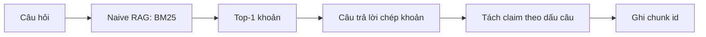

# Báo cáo tháng 1 — ViKAG-Faith

Ngày chốt: 2026-10-30. Mốc tháng 1 trong `KE_HOACH.md` là một báo cáo ngắn gồm sơ đồ pipeline, quyết định miền y tế, và một môi trường hỏi được một câu trên quy chế mẫu. Ba phần đó nằm ở mục 2, mục 4 và mục 5. Số liệu bài báo dưới đây đối chiếu trang HTML arXiv và thẻ Hugging Face trong ngày chốt, không lấy lại từ đề cương.

## 1. Kết luận tháng này

Miền y tế dùng nguyên bộ ViHERMES (`ura-hcmut/ViHERMES`), không dựng tập thay thế từ Thông tư 26/2025. Miền quy chế mẫu của tháng này là trích Thông tư 08/2021/TT-BGDĐT, thu thập ngày 2026-10-27, parser Điều/Khoản/Điểm đã chạy và Naive RAG (BM25) trả lời được câu hỏi.

Câu đã chạy: “Thời gian tối đa để sinh viên hoàn thành khóa học là bao lâu?”. Hệ `naive` trả về khoản 5 Điều 2, chunk `08-2021-tt-bgddt:d2:k5:p-`. Bản ghi đúng schema mục 6.5 nằm ở `data/thang1/mau_cau.json`. Trên cả 13 câu mẫu, top-1 gặp ít nhất một khoản vàng ở 13/13 câu và đủ mọi khoản vàng ở 12/13 câu. Câu hai khoản (`q12`) chỉ lấy được Điều 15 khoản 2, bỏ khoản 5 Điều 2 dù cạnh `REFERS_TO` đã có.

Hai hạng mục trong lịch tuần không đóng được trên máy này. Không có Java và không có Docker, nên Neo4j chưa cài; hợp đồng nạp đồ thị vẫn là `data/viedureg/load.cypher` và `data/kg/graph.json`. Nhánh dense (embedding neural) chưa có trọng số. Người thứ hai chưa gán 15 claim hiệu chỉnh, nên chưa có kappa. Guideline và phiếu trống đã sẵn.

## 2. Sơ đồ pipeline

Đề tài cuối cùng đi theo luồng: câu hỏi, một hệ truy hồi, câu trả lời, tách claim, căn bằng chứng, verifier ba nhãn, điểm GGF, rồi tối đa hai vòng sửa. Tháng 1 chỉ bắt buộc nhánh Naive RAG trên quy chế mẫu. Các hộp còn lại đã có mã ở các tháng sau nhưng không thuộc mốc tháng này.



Hợp đồng giữa các bước là id khoản. Parser sinh id dạng `doc:d{điều}:k{khoản}:p{điểm}`. Cùng id đó là node trên đồ thị và là chunk mà verifier đọc. Đó là mutual index thu nhỏ: tháng này mỗi khoản trỏ tới đúng đoạn văn của nó, chưa có lớp triple tách riêng. Câu mẫu không có cạnh đi ra, nên `evidence_triple_ids` để rỗng và `evidence_chunk_ids` ghi id khoản.

Lệnh tái tạo câu mẫu:

```bash
python run.py ask "Thời gian tối đa để sinh viên hoàn thành khóa học là bao lâu?" --system naive
```

Log cả 13 câu: `data/thang1/chay_naive.json`.

## 3. Bài đã đọc và phần mang vào đề tài

### 3.1. KAG

Liang và cộng sự, *KAG: Boosting LLMs in Professional Domains via Knowledge Augmented Generation*, arXiv:2409.13731. Hai cơ chế cần cho đề tài này là mutual indexing và logical form.

Mutual indexing nối phần tử đồ thị với đoạn văn gốc theo cả hai chiều. Truy được một thực thể thì lấy lại chunk đã sinh ra nó. Truy được một chunk thì lấy lại thực thể và quan hệ nằm trong chunk. Logical form biến câu hỏi thành một dạng có cấu trúc, rồi một solver thực thi dạng đó trên đồ thị thay vì chỉ xếp hạng đoạn bằng embedding.

Tháng 1 lấy mutual index ở mức khoản: id chunk bằng id node. Logical form và solver KAG không thuộc tháng này. Hệ `kag_style` trong repo là bản thu hẹp của các tháng sau, không phải KAG v0.8.

### 3.2. RAGAS

Es và cộng sự, *RAGAs: Automated Evaluation of Retrieval Augmented Generation*, EACL 2024, arXiv:2309.15217. Faithfulness của RAGAS tách câu trả lời thành các mệnh đề, hỏi từng mệnh đề có được ngữ cảnh truy hồi kéo theo hay không, rồi lấy tỉ lệ mệnh đề được kéo theo.

GGF giữ cùng tỉ lệ đó: số claim `supported` chia cho số claim. Điểm khác, và là lý do làm đề tài, nằm ở chỗ RAGAS gộp mọi mệnh đề không được kéo theo thành một phần trừ, còn GGF tách `contradicted` khỏi `unsupported` và buộc mệnh đề phải đối chiếu được với một khoản hoặc một triple. RAGAS dùng LLM làm người chấm, nên điểm đổi theo model chấm. Tháng 1 chưa gọi LLM cho thước này. Bản lexical trong `src/judges.py` chỉ là chỗ đứng, không được báo cáo như RAGAS.

### 3.3. ViHERMES

Nguyen và cộng sự, *ViHERMES: A Graph-Grounded Multihop Question Answering Benchmark and System for Vietnamese Healthcare Regulations*, arXiv:2602.07361. Thẻ Hugging Face `ura-hcmut/ViHERMES` ghi 1.561 câu hỏi, hop 1–5, 998 đơn vị pháp lý từ 490 văn bản Bộ Y tế, mỗi câu có context id, span bằng chứng và reasoning. Bảng thí nghiệm trên HTML arXiv dùng 1.560 câu, 312 câu mỗi mức hop. Hai con số lệch một câu giữa thẻ dữ liệu và bảng bài. Báo cáo sau này ghi rõ đang đếm cái nào.

Hệ của bài, cùng GPT-4o-mini và `text-embedding-3-small`, đạt F1 0.8334, LLM-judge 0.7554, Recall@5 0.8461. Bỏ Auditor, LLM-judge còn 0.6823 và F1 còn 0.8150. Naive hybrid RAG trong cùng bảng đạt F1 0.4127. Các số này là mốc tài liệu của bài gốc, không phải baseline của ViKAG-Faith, vì đề tài này không dùng GPT-4o-mini.

Auditor xác minh câu trả lời sau khi sinh. Nó cho thấy một bước kiểm có ích, nhưng điểm là điểm cả câu của LLM-judge, không phải macro-F1 ba nhãn trên từng claim và không có tương quan với người. Schema bài là đơn vị pháp lý cùng quan hệ sửa đổi, dẫn chiếu, hiệu lực. Loader `src/vihermes.py` đọc corpus và split test thành chunk phẳng theo `context_id`. Tháng 1 chưa dựng lại các đơn vị đó thành node Điều/Khoản.

### 3.4. ViHallu

*DSC2025 – ViHallu Challenge: Detecting Hallucination in Vietnamese LLMs*, arXiv:2601.04711. Bộ có 10.000 bộ ba context–prompt–response, ba nhãn: no hallucination, intrinsic, extrinsic. Ba kiểu prompt: factual, noisy, adversarial. Macro-F1 của hệ mạnh nhất trong bài là 84,80%, baseline encoder-only là 32,83%. Bài nhấn mạnh lớp intrinsic vẫn khó.

Ánh xạ sang nhãn đề tài là no → `supported`, intrinsic → `contradicted`, extrinsic → `unsupported`. Ánh xạ này chỉ để đặt related work. ViHallu gán cả một response, không gắn span với một triple, và không nằm trên văn bản quy chế. Tháng 1 không lấy ViHallu làm dữ liệu huấn luyện. Nếu mã mở sau này, nó là baseline hallucination tiếng Việt, đúng ngoài phạm vi đã ghi trong kế hoạch.

### 3.5. ViNLI và VLUE

Huynh, Nguyen và Nguyen, *ViNLI: A Vietnamese Corpus for Studies on Open-Domain Natural Language Inference*, COLING 2022. Corpus có 30.376 cặp câu người gán, lấy từ hơn 800 bài báo, 13 chủ đề. Bốn nhãn: entailment, contradiction, neutral, và other. Other dành cho cặp không cùng sự kiện, khác neutral. Bài nói corpus công bố cho nghiên cứu. Không thấy một giấy phép SPDX được nêu trên trang đã đối chiếu, nên tháng 4 chỉ nạp nếu điều kiện tải vẫn là nghiên cứu.

VLUE (arXiv:2403.15882, Findings of NAACL 2024) đưa ViNLI vào benchmark với split 24.376 / 3.009 / 2.991 và thước Accuracy cùng F1. Ánh xạ dự kiến khi huấn luyện verifier: entailment → `supported`, contradiction → `contradicted`, neutral → `unsupported`. Other không được đổ vào unsupported mà không ghi riêng, vì cặp không liên quan khác một claim thêm điều kiện. ViNLI là cặp câu báo chí, chưa phải claim đối chiếu khoản. Kế hoạch dùng nó làm khởi tạo, rồi học tiếp trên claim tổng hợp. Tháng 1 chưa tải tập này.

### 3.6. R2GQA và ViRHE4QA

Pham Do và cộng sự, *R2GQA: Retriever-Reader-Generator Question Answering System to Support Students Understanding Legal Regulations in Higher Education*, arXiv:2409.02840. ViRHE4QA có 9.758 cặp hỏi–đáp trên quy định giáo dục đại học, gồm đáp án trích nhiều span và đáp án diễn đạt lại. R2GQA có ba khối: retriever, reader, generator. Bài nói đây là bộ tiếng Việt đầu tiên trên miền quy chế đại học có cả hai kiểu đáp án, và dataset để phục vụ nghiên cứu.

Cùng miền với ViEduReg, nhưng sản phẩm của họ là câu trả lời, không phải nhãn claim `supported` / `contradicted` / `unsupported` gắn đồ thị. Tháng 1 không thay ViEduReg bằng ViRHE4QA. Bài này xác nhận khoảng trống: hỏi đáp quy chế đã có, kiểm chứng mức mệnh đề thì chưa.

## 4. Quyết định miền y tế

Cổng dữ liệu mở. Bộ test và corpus nằm trên Hugging Face, loader đã có trong `src/vihermes.py`, và demo đã có lối vào miền này tách khỏi chỉ mục BM25 của quy chế. Vì vậy không chuyển sang phương án thay thế.

Phương án thay thế đã loại là Thông tư 26/2025 về kê đơn. Một thông tư không thay được 490 văn bản và 1.561 câu đã có evidence. Khi đánh giá faithfulness trên y tế, câu hỏi và context id lấy từ split test của ViHERMES. Đồ thị Điều/Khoản của quy chế không trộn vào chỉ mục y tế, để BM25 quy chế không đổi.

Việc còn lại trên miền này không thuộc tháng 1: ánh xạ đơn vị ViHERMES sang schema Điều/Khoản, và chạy năm hệ trên tập test. Số 0.7554 và 0.6823 chỉ được trích như kết quả của bài gốc.

## 5. Quy chế mẫu và câu đã chạy

Nguồn: Thông tư 08/2021/TT-BGDĐT, Công báo số 569+570 ngày 04/5/2021. URL lưu trong `src/legal_corpus.py`. Ngày tải bản dùng trong repo: 2026-10-27. Đây là trích các điều phục vụ 13 câu, không phải toàn văn. Từ 07/07/2026, Thông tư 56/2026 thay thế thông tư này với khóa tuyển sinh năm 2026. Khóa đã có thông báo tuyển sinh trước ngày đó vẫn theo quy chế tại thời điểm thông báo. Tháng 1 cố ý hỏi trên bản 08/2021 vì 13 câu đã đối chiếu điều khoản. Thông tư 56/2026 là việc của tháng 2.

Parser `src/parse_legal.py` nhận một điều, tách tiêu đề Điều, khoản `N.` và điểm `a)`. Cụm “khoản N Điều M” thành cạnh `REFERS_TO`. Mỗi điểm là một span. Câu mở đầu của khoản được ghép vào context của điểm để còn chủ thể.

Đồ thị dựng ngày 2026-10-30 có 44 chunk và 5 cạnh, cả năm đều là `REFERS_TO` trỏ tới khoản 5 Điều 2. Không có cạnh `REPEALS` trong trích này. Lệnh `python run.py build` ghi `data/kg/graph.json`.

Naive RAG trong `src/graph.py` xếp BM25 (k1 = 1,5, b = 0,75) rồi đưa đúng một khoản đứng đầu vào câu trả lời. Câu trả lời là nguyên văn khoản, chưa phải văn LLM viết lại. Điều đó đủ cho mốc “chạy được một câu”. Nó chưa phải thí nghiệm faithfulness của câu sinh tự do.

Kết quả 13 câu (`data/thang1/chay_naive.json`):

| Câu | Hop | Chunk top-1 | Đủ khoản vàng |
| --- | --- | --- | --- |
| q01–q11, q13 | 1 | đúng khoản trong `questions.json` | có |
| q12 | 2 | `08-2021-tt-bgddt:d15:k2:p-` | không, thiếu `d2:k5` |

q12 hỏi hai việc: nghỉ tạm thời có tính vào thời gian học tối đa hay không, và thời gian tối đa là bao nhiêu. Top-1 trả lời được việc thứ nhất bằng Điều 15 khoản 2. Việc thứ hai nằm ở khoản 5 Điều 2, và parser đã nối hai khoản bằng `REFERS_TO`. BM25 không đi cạnh đó. Đây là quan sát để các tháng sau so hệ graph với naive, không phải lỗi parser.

Câu q01, ghi đủ trường schema 6.5 trong `data/thang1/mau_cau.json`:

- `question_id`: q01
- `system`: naive
- `hop`: 1
- `evidence_chunk_ids`: `08-2021-tt-bgddt:d2:k5:p-`
- Hai claim, cả hai `supported`, vì bộ tách câu cắt khoản 5 thành hai câu và cả hai câu đều nằm trong khoản

Trích câu trả lời: thời gian tối đa không vượt quá 02 lần thời gian theo kế hoạch học tập chuẩn toàn khóa đối với mỗi hình thức đào tạo.

## 6. Neo4j và nhánh dense

Lịch tuần bảo cài Neo4j và hỏi bằng BM25 cộng dense. Máy chạy báo cáo này không có lệnh `java`, `docker` hay `neo4j`. Không tải bộ cài Neo4j Desktop trong tháng này. Đồ thị xem được bằng `data/kg/graph.json` của quy chế mẫu và bằng `data/viedureg/load.cypher` khi có Neo4j. Cypher tạo node `Clause` theo id khoản và cạnh `REFERS_TO`, `REPLACES`.

Dense trong kế hoạch là `AITeamVN/Vietnamese_Embedding` hoặc BGE-M3, trộn với BM25 bằng RRF. Trọng số chưa nằm trong môi trường. Top-1 hiện tại là BM25 thuần. Gọi một vector TF-IDF là dense sẽ làm sai bảng về sau, nên tháng 1 không thêm nhánh đó. Khi có model, cùng 13 câu trong `chay_naive.json` là tập kiểm tra hồi quy: q12 phải lấy thêm khoản 5 Điều 2 thì nhánh graph hoặc dense mới hơn BM25 trên câu hai khoản.

## 7. Guideline và 15 claim hiệu chỉnh

Guideline ba nhãn nằm ở `data/guideline_nhan.md`. Bộ hiệu chỉnh tháng 1 có 15 claim trong `data/thang1/hieu_chinh_15_a.json`. Mười một claim bám câu trả lời Naive RAG. Bốn claim còn lại là biến thể cố ý để thử biên: 30% đổi thành 50% (`contradicted`), cảnh báo đổi thành buộc thôi học (`contradicted`), “02 lần” viết thành “hai lần” (`supported`), và thêm “thưởng 3 triệu đồng” vào câu cấp bằng (`unsupported`, span rỗng).

Người thứ nhất ghi thêm hai nhận xét cho tháng 3. Claim m09 dính hai hệ quả, đình chỉ một năm và buộc thôi học, nên `atomicity` là false dù nhãn cả câu vẫn supported. Claim m10 được khoản 15 nâng đỡ, nhưng câu trả lời của q12 không phủ con số 02 lần. Đó là lỗi độ phủ của câu trả lời, không đổi nhãn claim. GGF chỉ có nghĩa sau khi coverage của bước tách được đo, đúng mục 5.2 của kế hoạch.

Phiếu người thứ hai là `data/thang1/hieu_chinh_15_r2.json`, nhãn đang trống, kèm đoạn khoản cần đọc. Họ không mở file của người thứ nhất trước khi điền. Lệnh sau khi điền:

```bash
python run.py kappa --a data/thang1/hieu_chinh_15_a.json --b data/thang1/hieu_chinh_15_r2.json
```

Nếu κ dưới 0,6 thì sửa guideline rồi gán lại, đúng quy tắc đã ghi. Tháng 1 chưa có số κ.

## 8. Sang tháng 2

Tháng 2 nhận quy chế còn hiệu lực, parser, đồ thị và bộ câu ViEduReg. Phần đó đã có bản chạy trên Thông tư 56/2026 và không được tính là đã chốt, vì còn duyệt và κ. Tháng 1 bàn giao cho tháng 2 ba thứ: quyết định không trộn y tế vào chỉ mục quy chế, id khoản làm khóa giữa parser và câu trả lời, và quan sát rằng BM25 bỏ khoản được dẫn bởi `REFERS_TO` trên câu hai khoản.

Việc không mang sang như thể đã xong: Neo4j đang chạy, BM25+dense, kappa 15 claim, và việc nạp ViNLI.
