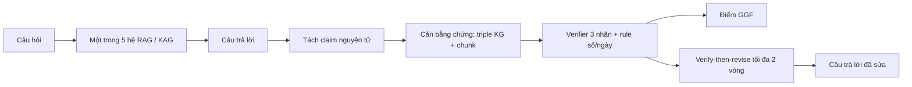

# Kế hoạch Project 4 — ViKAG-Faith

**Tên đề tài.** Đánh giá và kiểm chứng tính trung thực (faithfulness) mức mệnh đề cho KAG/GraphRAG tiếng Việt dựa trên đồ thị tri thức: nghiên cứu trên quy chế đào tạo và quy định y tế.

**Tên tiếng Anh.** ViKAG-Faith: Graph-Grounded Claim-Level Faithfulness Evaluation and Verification for Vietnamese Knowledge-Augmented Generation.

**Ưu tiên trong đề cương:** 2 (sau TempLaw-KAG). Độ khó trung bình–thấp, GPU 24GB là đủ, phụ thuộc dữ liệu ngoài thấp, khả năng công bố cao (VLSP, PACLIC, KSE; Findings ACL/EMNLP nếu meta-evaluation chắc).

**Sản phẩm cuối.** Bộ claim đã gán nhãn ViFaithKAG, verifier nhỏ, thước Graph-Grounded Faithfulness (GGF), thí nghiệm verify-then-revise, và demo chatbot quy chế đào tạo có trích dẫn.

---

## 1. Vì sao làm đề tài này

GraphRAG và KAG tiếng Việt đang được chấm bằng F1 hoặc LLM-judge trên cả câu trả lời. Hai thước đó không chỉ ra mệnh đề nào được một triple hoặc một chunk nâng đỡ, mệnh đề nào nói ngược văn bản, mệnh đề nào bịa thêm.

Khoảng trống số 7 trong đề cương nói đúng điểm này: ViHallu (DSC2025) gán hallucination tiếng Việt theo nhãn no / intrinsic / extrinsic, và chưa gắn nhãn đó với đồ thị tri thức. ViHERMES có module Auditor; khi bỏ Auditor, điểm LLM-judge giảm từ 0.7554 xuống 0.6823. Auditor cho thấy kiểm chứng có ích, nhưng chưa thành một thước claim-level công khai, đo được tương quan với người, và so được với RAGAS.

Quy chế đào tạo là miền phù hợp để gán nhãn: câu trả lời sai ảnh hưởng trực tiếp tới sinh viên (điều kiện tốt nghiệp, điểm, thời hạn), và người trong trường đọc được văn bản gốc. Quy định y tế dùng bộ ViHERMES làm miền thứ hai, nơi graph theo cấu trúc điều–khoản đã có kết quả đối chứng.

Đề tài này chạy được khi Project 1 chưa xong. Hệ thứ năm trong đề cương (“P1 nếu có”) là cộng thêm, không phải điều kiện để bắt đầu.

## 2. Câu hỏi nghiên cứu

| Mã | Câu hỏi | Cách trả lời |
| --- | --- | --- |
| RQ1 | RAGAS faithfulness và LLM-judge khớp với người tới mức nào trên tiếng Việt, ở hai miền này? | Tương quan Spearman và Kendall giữa điểm tự động và điểm người, tính trên từng câu trả lời |
| RQ2 | Verifier nhìn cả triple lẫn chunk có phân loại đúng hơn verifier chỉ nhìn chunk không? | Macro-F1 ba nhãn và AUROC phát hiện claim sai; ablation bỏ triple, bỏ rule số/ngày |
| RQ3 | Verify-then-revise giảm bao nhiêu claim contradicted và unsupported, và F1/EM của câu trả lời đổi ra sao? | So GGF, tỉ lệ contradicted, EM/F1 ở vòng 0, 1 và 2 |

## 3. Đóng góp kỳ vọng

1. **ViFaithKAG** — khoảng 3.000 claim tiếng Việt, mỗi claim có nhãn `supported` / `contradicted` / `unsupported`, span bằng chứng, và liên kết tới triple hoặc chunk.
2. **Verifier nhỏ** — cross-encoder (PhoBERT-large hoặc XLM-R) và/hoặc Qwen 1.5–4B, fine-tune từ ViNLI cùng claim–evidence tổng hợp. Rule đối chiếu số và ngày với thuộc tính trên KG.
3. **GGF** — thước tự động mức mệnh đề, có meta-evaluation với người, đặt cạnh RAGAS và LLM-judge.
4. **Toán tử Verify** — gắn sau generator của KAG/GraphRAG: claim lỗi được trả lại kèm bằng chứng để sửa hoặc xoá, tối đa hai vòng.
5. **Demo** — chatbot hỏi đáp quy chế đào tạo, mỗi câu trả lời kèm claim đã kiểm và trích điều/khoản.

## 4. Phạm vi

**Trong phạm vi**

- Hai miền văn bản có cấu trúc điều–khoản: quy định y tế (ưu tiên dữ liệu ViHERMES) và quy chế đào tạo đại học / thạc sĩ.
- Năm họ hệ sinh câu trả lời, cùng một LLM và cùng một embedding: Naive RAG, LightRAG, HippoRAG 2, KAG với prompt tiếng Việt, và TempLaw-KAG nếu Project 1 đã chạy được.
- Faithfulness mức mệnh đề. Chất lượng retrieval (Recall@k) và EM/F1 chỉ là thước phụ, để xem vòng sửa có làm câu trả lời lệch đáp án vàng hay không.

**Ngoài phạm vi**

- Xây KG pháp lý đa miền, toán tử thời gian `as_of`, hay planner SFT. Đó là Project 1 và Project 3.
- Gán nhãn hallucination tự do trên văn phong, khi không có đoạn nguồn. ViHallu giữ vai trò baseline nếu có mã.
- Công bố nguyên văn quy chế nội bộ. Phần nội bộ chỉ dùng khi được phép; bản công khai của dataset là văn bản cấp Bộ và câu hỏi/span tương ứng.

## 5. Phương pháp

Luồng một câu hỏi:



### 5.1. Đồ thị tri thức

Giữ schema cấu trúc, cùng họ với ViHERMES và với graph rule của Project 1, để hai miền so được với nhau:

- Node: `VanBan`, `Chuong`, `Dieu`, `Khoan`, `Diem`.
- Thuộc tính tối thiểu: số hiệu, cơ quan ban hành, ngày ban hành, `valid_from`, `valid_to`, tình trạng hiệu lực tại ngày thu thập.
- Cạnh rule: `HAS_ARTICLE`, `HAS_CLAUSE`, `AMENDS`, `REPLACES`, `REPEALS`, `REFERS_TO`. Pattern xuất phát: “sửa đổi Điều …”, “thay thế …”, “bãi bỏ …”.
- Mutual index: mỗi node điều/khoản trỏ tới chunk gốc. Chunk là đơn vị verifier đọc, triple là đơn vị rule số/ngày đọc.

KG quy chế do project này dựng. KG y tế dùng bản ViHERMES nếu mã và dữ liệu mở; nếu bản đó chưa mở, dựng KG cùng schema trên một tập thông tư/quyết định y tế công khai, thu hẹp số văn bản và ghi rõ tập thay thế trong báo cáo.

### 5.2. Tách claim

LLM (cùng họ với model sinh, bản instruct) tách câu trả lời bằng prompt tiếng Việt có 8–12 ví dụ. Một rule hậu kiểm: mỗi claim còn một vị từ chính (một quan hệ, một mệnh đề điều kiện). Claim dính hai vị từ bị tách lại hoặc loại khỏi tập chấm và được đếm vào tỉ lệ lỗi tách.

Trước khi chấm cả bộ, duyệt tay 100 câu trả lời:

- **Atomicity:** claim có đúng một khẳng định.
- **Coverage:** gộp các claim thì còn đủ ý của câu trả lời; ý bị rơi ghi vào lỗi coverage.

Báo cáo hai tỉ lệ này. GGF chỉ có nghĩa khi coverage đủ cao.

### 5.3. Căn bằng chứng

Với mỗi claim, lấy ba lớp bằng chứng:

1. Triple của các node hệ thống đã dùng trong lần truy hồi đó (nếu hệ có trace). Node không có trace thì nối bằng entity linking: khớp số hiệu điều/khoản, rồi embedding lên tên thực thể trong claim.
2. Chunk gốc của những node đó, qua mutual index.
3. Top-k chunk dense/sparse bổ sung, để verifier vẫn có bằng chứng khi bước 1–2 trượt. Ablation “bỏ triple” dùng lớp 2–3; ablation “chỉ chunk đã truy xuất” bỏ lớp 3.

Mỗi claim lưu `evidence_triple_ids` và `evidence_chunk_ids` dù nhãn cuối là unsupported, để người gán nhãn thấy hệ đã đưa gì cho model.

### 5.4. Nhãn

| Nhãn | Điều kiện |
| --- | --- |
| `supported` | Có ít nhất một triple hoặc một span kéo theo claim. Số, ngày, điều kiện áp dụng khớp nguồn. |
| `contradicted` | Nguồn khẳng định sự kiện xung đột: số khác, ngày khác, cho phép đảo thành cấm, hoặc điều đã hết hiệu lực được nói như còn hiệu lực. |
| `unsupported` | Nguồn không kéo theo claim và cũng không nói ngược. Claim thêm điều kiện, đối tượng, hoặc hậu quả không có trong bằng chứng. |

`contradicted` là lớp nguy hiểm, báo cáo riêng, không gộp vào “sai” chung với `unsupported`.

Span bằng chứng là đoạn ngắn nhất trên chunk hoặc chuỗi đọc được của triple mà người gán dùng để quyết định. Claim `unsupported` có span rỗng và vẫn lưu danh sách bằng chứng đã xem.

### 5.5. Verifier

Hai mô hình, cùng tập huấn luyện, để trả lời “encoder nhỏ hay LLM nhỏ”:

- Cross-encoder PhoBERT-large hoặc XLM-R, đầu ra ba nhãn. Đầu vào là claim nối với phần đọc được của triple và chunk.
- Qwen 1.5–4B fine-tune, đầu ra nhãn kèm span bằng chứng.

Thêm tầng rule tất định, chạy trước hoặc song song với model:

- Tách số và ngày trong claim (tín chỉ, điểm, học kỳ, thời hạn, liều, ngưỡng).
- So với thuộc tính KG và với số/ngày trong span. Lệch giá trị thì gán ứng viên `contradicted`, model không được phủ quyết thành `supported`.

Dữ liệu huấn luyện verifier:

- ViNLI (VLUE, hơn 30.000 cặp) ánh xạ sang ba nhãn ở mức có thể: entailment → supported, contradiction → contradicted, neutral → unsupported. Đây là khởi tạo, vì ViNLI là cặp câu chứ chưa phải claim–KG.
- Khoảng 20.000 cặp claim–evidence tổng hợp từ chunk nằm ngoài tập câu hỏi test. Bản supported là claim bám câu nguồn. Bản contradicted đổi số, đổi ngày, hoặc phủ định (“được” / “không được”, “còn hiệu lực” / “hết hiệu lực”). Bản unsupported thêm một điều kiện không có trong đoạn.

Tập người gán không trộn vào huấn luyện rồi lại đem ra báo cáo. Phần dev người gán (mục 6.4) mới được dùng để chọn ngưỡng; phần test người gán chỉ để meta-evaluation.

### 5.6. Thước GGF

Trên một câu trả lời có n claim:

- **GGF** = số claim `supported` / n
- **Tỉ lệ contradicted** = số claim `contradicted` / n
- **Tỉ lệ unsupported** = số claim `unsupported` / n

Điểm hệ thống là trung bình trên câu hỏi, kèm theo loại câu (1-hop và multi-hop) và theo miền (y tế, quy chế). Một số trung bình toàn bộ là chưa đủ, đúng yêu cầu phương pháp của đề cương.

### 5.7. Verify-then-revise

Claim không phải `supported` được đưa lại generator cùng nhãn, span xung đột nếu có, và chỉ thị sửa hoặc xoá đúng claim đó. Tối đa hai vòng. Vòng sau tách claim và chấm lại.

Giữ đáp án vàng của câu hỏi để đo EM/F1 sau mỗi vòng. Mục tiêu là contradicted giảm trong khi EM/F1 không tụt mạnh. Nếu GGF tăng vì model xoá hết câu, EM/F1 sẽ lộ điều đó.

## 6. Dữ liệu

### 6.1. ViHERMES (miền y tế–pháp quy)

Bộ test gốc: 1.560 câu, mỗi mức 1–5 hop có 312 câu, có evidence và reasoning. Hệ multi-agent của bài đạt F1 0.8334, LLM-judge 0.7554, Recall@5 0.8461; HippoRAG 2 đạt F1 0.8023; naive hybrid RAG đạt F1 0.4127. Bài dùng GPT-4o-mini và `text-embedding-3-small`. Project này chạy lại trên LLM mở, nên các số đó là mốc tài liệu, không phải baseline của bài này.

Việc tuần 1: kiểm tra bản PDF/code/data tại [arXiv:2602.07361](https://arxiv.org/abs/2602.07361). Cổng này quyết định miền y tế dùng nguyên bộ hay dùng tập thay thế.

### 6.2. ViEduReg (miền quy chế)

Khoảng 500 câu. Khoảng 40% là multi-hop (một câu cần từ hai điều, hoặc cần biết điều nào còn hiệu lực sau sửa đổi).

Nguồn văn bản, kiểm tra hiệu lực vào ngày thu thập trên cơ sở dữ liệu quốc gia về văn bản pháp luật:

- Quy chế đào tạo trình độ đại học và các thông tư sửa đổi, bổ sung, thay thế.
- Quy chế đào tạo trình độ thạc sĩ ở cấp Bộ.
- Quy định nội bộ của trường chỉ khi được phép dùng và được phép công bố. Phần không được công bố thì không đưa vào bản phát hành.

Mỗi câu lưu: `question`, `gold_answer`, `hop`, `evidence_dieu_khoan`, `as_of` (ngày giả định của câu hỏi), `source_url`.

Cách sinh câu, theo tinh thần pipeline ViHERMES rồi thu hẹp cho một người làm:

1. Lấy mẫu cặp (điều, khoản) và các cạnh sửa đổi/tham chiếu.
2. Viết template (điều kiện, thời hạn, số tín chỉ, ngoại lệ, “văn bản nào đang có hiệu lực”).
3. LLM diễn đạt lại.
4. Người duyệt 100% tập test. Câu mơ hồ hoặc không có một đáp án trong văn bản thì loại.

Hai người gán trên tập test quy chế thì báo cáo Cohen’s κ. Nếu chỉ có một người viết câu và giảng viên duyệt, ghi rõ vai trò và κ trên phần được duyệt kép (tối thiểu 100 câu).

### 6.3. Đầu ra năm hệ thống

Cùng LLM, cùng embedding, cùng ngày cắt corpus.

| Hệ | Vai trò |
| --- | --- |
| Naive RAG | BM25 + dense, trộn RRF. Có thể kế thừa cách làm ở assignment 2, đổi corpus và embedding |
| LightRAG | Graph nhẹ, dual-level retrieval |
| HippoRAG 2 | OpenIE + Personalized PageRank |
| KAG, prompt tiếng Việt | Logical form; nếu OpenSPG quá nặng thì solver tối giản LangGraph + Neo4j, ghi rõ đó là KAG-style chứ không phải bản v0.8 nguyên khối |
| TempLaw-KAG | Chỉ khi Project 1 có graph và solver. Không thì dừng ở bốn hệ |

Mỗi hệ chạy trên tập câu đã chốt (ViHERMES test hoặc tập con, cộng ViEduReg). Lưu answer, danh sách chunk, danh sách node/triple, token và latency.

Ước lượng đề cương: 5 hệ × khoảng 600 câu, rồi lấy mẫu khoảng 3.000 claim. Cách lấy mẫu:

- Phân tầng theo hệ × miền × nhóm hop.
- Giữ phân phối tự nhiên trên tập test meta-evaluation.
- Có thể tăng tỷ lệ claim lệch số/ngày trong **tập dev** để verifier gặp lớp contradicted. Tập test giữ tỷ lệ tự nhiên, và báo cáo cả hai.

### 6.4. Gán nhãn claim

Quy mô mục tiêu: khoảng 3.000 claim, 3 nhãn + span, 2–3 người, khoảng 20% dev.

Chia theo **câu hỏi**, không chia theo claim. Mọi claim của một câu trả lời nằm cùng phía dev hoặc test.

| Tình huống nhân lực | Quy mô | Cách đo κ |
| --- | --- | --- |
| Hai người gán cả bộ | ~3.000 claim | Cohen’s κ trên toàn bộ, người thứ ba xử lý bất đồng |
| Một học viên + giảng viên | ~1.200–1.500 claim là bản nộp môn; hướng ~3.000 nếu còn tháng 4 | Gán kép ít nhất 300 claim để tính κ |

Tuần gán nhãn bắt đầu bằng 100 claim hiệu chỉnh. Guideline kèm ví dụ biên: số đúng nhưng thiếu điều kiện; trích đúng điều nhưng điều đã bị thay thế; paraphrase đúng; đơn vị đo đổi cách viết (15 tín chỉ và “mười lăm tín chỉ”).

### 6.5. Bản ghi

`data/claims/claims.jsonl`, một dòng một claim:

```json
{
  "claim_id": "edu-0042-hipporag2-03",
  "question_id": "edu-0042",
  "domain": "viedureg",
  "system": "hipporag2",
  "hop": 2,
  "answer": "...",
  "claim_text": "...",
  "label": "contradicted",
  "evidence_span": "...",
  "evidence_triple_ids": ["dieu-12-khoan-1"],
  "evidence_chunk_ids": ["chunk-188"],
  "split": "test",
  "annotators": ["a", "b"],
  "adjudicated_label": "contradicted"
}
```

## 7. Thực nghiệm

### 7.1. Baseline của thước và của verifier

| Baseline | So với cái gì |
| --- | --- |
| RAGAS faithfulness, backend là LLM mở cùng họ | RQ1, tương quan với người |
| LLM-judge theo rubric ngắn (supported / contradicted / unsupported trên cả câu, rồi quy về tỷ lệ) | RQ1 |
| SelfCheckGPT kiểu nhất quán nhiều lần sinh | Thước không dùng nguồn |
| NLI đa ngôn ngữ zero-shot | Verifier không fine-tune |
| Hệ mạnh của ViHallu, nếu có mã | Hallucination tiếng Việt không gắn KG |

LLM-judge trong đề cương là Qwen2.5-32B-AWQ. Máy 24GB dùng bản 14B và ghi cấu hình đó trong bảng, không trộn điểm của hai cỡ model.

### 7.2. Chỉ số

**Verifier:** macro-F1 ba nhãn, F1 từng nhãn, AUROC khi lớp dương là `contradicted ∪ unsupported`.

**Thước:** Spearman và Kendall giữa GGF tự động và GGF người, tính ở mức câu trả lời. Cùng cách tính cho RAGAS và LLM-judge. Báo cáo khoảng tin cậy bằng bootstrap trên câu hỏi.

**Revise:** ΔGGF, Δ tỉ lệ contradicted, Δ EM/F1 sau vòng 1 và vòng 2.

**Phụ:** Recall@5 evidence, latency, số token indexing. EM/F1 chuẩn hoá dấu và viết thường.

### 7.3. Ablation

- Bỏ triple, chỉ còn chunk.
- Bỏ rule số/ngày.
- PhoBERT-large so với Qwen 1.5–4B.
- Có và không có 20.000 mẫu tổng hợp.
- Số vòng revise: 0, 1, 2.
- Kết quả verifier trên claim thật, tách khỏi kết quả trên claim tổng hợp.

### 7.4. Điều kiện để kết luận

- RQ2 chỉ kết luận khi macro-F1 trên tập test người gán tăng và khoảng bootstrap không phủ hết mức chênh bằng 0, hoặc khi tăng tập trung ở lớp contradicted dù macro-F1 đứng yên. Lớp contradicted được báo cáo dù macro-F1 không đẹp.
- RQ1 báo cáo hệ số tương quan kể cả khi tương quan ở mức trung bình. Đó vẫn là kết quả của đề tài.
- RQ3 cần cả ba số: GGF, contradicted, EM/F1. Thiếu EM/F1 thì không kết luận vòng sửa “không làm hỏng câu trả lời”.

## 8. Hạ tầng

**Cấu hình đề cương (ưu tiên):** GPU 24GB. LLM sinh: Qwen2.5-7B-Instruct hoặc Qwen3-8B qua vLLM. Embedding: `AITeamVN/Vietnamese_Embedding` hoặc BGE-M3. Reranker: `bge-reranker-v2-m3`. Graph: Neo4j. Judge lớn hơn model sinh khi có GPU 48GB (Qwen2.5-32B-AWQ); trên 24GB thì judge 14B.

**Cấu hình máy đã dùng ở assignment 2:** không có GPU riêng, Ollama `qwen3:4b`, embedding nhỏ. Project vẫn chạy được nếu thu hẹp đúng chỗ:

- Bốn hệ, bỏ KAG nguyên khối; Naive RAG và một graph (LightRAG hoặc HippoRAG 2) là bắt buộc, hệ thứ ba và thứ tư thêm khi còn thời gian.
- Sinh câu trả lời theo lô, cache, chạy qua đêm.
- Verifier là PhoBERT hoặc một cross-encoder nhỏ hơn PhoBERT-large nếu VRAM/RAM không đủ; Qwen 4B qua Ollama dùng làm verifier few-shot, còn fine-tune để sau.
- Tập claim bản môn học: 1.200, trong đó 300 gán kép.

Mọi bảng kết quả ghi tên model, lượng tử hoá, và số câu. Không so một hệ chạy 7B với một hệ chạy 4B.

## 9. Cấu trúc thư mục

```
cuoi_ky_prj4/
  README.md
  KE_HOACH.md
  requirements.txt          # khi bắt đầu cài môi trường
  src/
    corpus/                 # tải văn bản, parser Điều/Khoản
    kg/                     # dựng node, cạnh, mutual index
    generate/               # gọi 4–5 hệ, một interface chung
    claims/                 # tách claim, căn bằng chứng
    verify/                 # rule số/ngày, train, predict
    eval/                   # GGF, tương quan, revise
    demo/                   # chatbot quy chế
  data/
    corpus/                 # văn bản + meta hiệu lực
    kg/
    questions/              # ViEduReg, danh sách id ViHERMES
    outputs/                # câu trả lời từng hệ
    claims/                 # claims.jsonl
    synthetic/
  eval/                     # bảng kết quả
  configs/                  # model, seed, ngày as_of
```

Phần mã để trống cho đến khi bước thu thập bắt đầu. Hợp đồng giữa các bước là file jsonl ở trên, để mỗi tháng đổi được từng module.

## 10. Lịch 6 tháng

Đề cương ghi “kế hoạch 6 tháng” nhưng liệt kê Tuần 1–5. Khối lượng khoảng 3.000 claim và năm hệ thống không nằm trong năm tuần. Lịch dưới đây giữ đúng các đầu việc đó, trải trên sáu tháng. Cột “mốc xong” là điều kiện sang tháng sau.

| Tháng | Việc | Mốc xong |
| --- | --- | --- |
| 1 | Đọc KAG, RAGAS, ViHERMES, ViHallu, ViNLI, R2GQA/ViRHE4QA. Chốt cổng dữ liệu ViHERMES. Cài Neo4j, chạy Naive RAG trên một quy chế mẫu | Báo cáo 5–7 trang: sơ đồ pipeline, quyết định miền y tế, môi trường chạy được một câu |
| 2 | Thu thập quy chế còn hiệu lực, parser điều/khoản, KG rule, 500 câu ViEduReg, duyệt câu | `ViEduReg` v1, graph xem được trên Neo4j, κ hoặc biên bản duyệt |
| 3 | Chạy đủ hệ trên cùng LLM. Tách claim. Guideline. Gán 100 claim hiệu chỉnh, rồi gán chính | Đầu ra hệ thống đã cache; guideline đóng; ≥40% claim đã có nhãn kép hoặc nhãn đơn theo phương án nhân lực |
| 4 | Gán nốt. Sinh 20.000 cặp tổng hợp từ passage ngoài test. Huấn luyện verifier. Chọn mô hình trên dev | `claims.jsonl` đủ split; macro-F1 dev của verifier tốt nhất; κ đã tính |
| 5 | Meta-evaluation RQ1–RQ2. Verify-then-revise RQ3. Ablation | Bảng đầy đủ, kèm bootstrap và phân tích lỗi theo hop / số / hiệu lực |
| 6 | Viết bài. Demo chatbot quy chế: câu hỏi → câu trả lời → từng claim và nhãn. Công khai phần được phép (câu hỏi, nhãn, mã, URL văn bản) | Bản thảo + demo chạy trên 20 câu cầm tay |

**Nếu môn chỉ còn một học kỳ (khoảng 12 tuần):** làm tháng 1–2 trong bốn tuần đầu, chỉ Naive RAG + LightRAG + HippoRAG 2, 150 câu quy chế, 1.200 claim, verifier PhoBERT hoặc few-shot, một vòng revise. Tháng-việc 5 và 6 gộp thành bốn tuần cuối. Bộ 3.000 claim và KAG đầy đủ là phần mở rộng, không chặn bài nộp môn.

## 11. Rủi ro

| Rủi ro | Cách xử lý |
| --- | --- |
| ViHERMES chưa công bố data/code | Tuần 4 của tháng 1 phải chốt. Phương án thay: KG cùng schema trên văn bản y tế công khai, ít văn bản hơn, câu hỏi do mình sinh và duyệt |
| Gán nhãn lệch nhau | 100 claim hiệu chỉnh; ví dụ biên trong guideline; κ dưới 0.6 thì dừng gán hàng loạt, sửa guideline, gán lại phần dev |
| Quy chế nội bộ không được phát hành | Dataset công khai chỉ gồm văn bản cấp Bộ, câu hỏi, span, nhãn |
| Claim tổng hợp dễ hơn claim thật | Bảng verifier tách hai tập. Kết luận RQ2 lấy trên claim người gán |
| KAG v0.8 khó sửa prompt và solver | Bốn hệ kia vẫn đủ cho RQ1–RQ3. Solver tiếng Việt tối giản được ghi là KAG-style |
| LLM-judge và model sinh cùng cỡ | Ghi rõ trong bài. Khi có 48GB thì chạy lại cột judge 32B, không ghi đè kết quả 14B |
| Văn bản đổi hiệu lực giữa chừng | Mỗi đợt thu thập lưu ngày crawl, URL, tình trạng. Câu hỏi thời gian mang trường `as_of` |
| Vòng revise xoá cụt câu cho GGF tăng | Luôn đọc EM/F1 kèm GGF |

## 12. Bài nộp và demo

- Bản thảo theo cấu trúc đề cương: Introduction, Related Work, Method, Dataset, Setup, Results, Ablation.
- `claims.jsonl`, guideline gán nhãn, script tính κ và GGF.
- Bảng RQ1–RQ3 và ablation.
- Demo: một câu quy chế, câu trả lời, danh sách claim với nhãn và điều/khoản nguồn. Hai mươi câu cầm tay chuẩn bị sẵn để máy chậm vẫn trình bày được.

Venue mục tiêu giữ như đề cương: VLSP, PACLIC, KSE trước; Findings ACL/EMNLP khi tương quan và ablation đã chặt; tạp chí ACM TALLIP hoặc Knowledge-Based Systems nếu bài được mở rộng.

## 13. Tài liệu chính

- Liang et al. KAG. arXiv:2409.13731. https://arxiv.org/abs/2409.13731
- RAGAS. Es et al., EACL 2024 Demo. arXiv:2309.15217. https://aclanthology.org/2024.eacl-demo.16/
- ViHERMES. arXiv:2602.07361. https://arxiv.org/abs/2602.07361
- ViHallu. arXiv:2601.04711. https://arxiv.org/abs/2601.04711
- VLUE / ViNLI. arXiv:2403.15882. https://arxiv.org/abs/2403.15882
- HippoRAG 2. arXiv:2502.14802. https://arxiv.org/abs/2502.14802
- LightRAG. arXiv:2410.05779. https://arxiv.org/abs/2410.05779
- GraphRAG. arXiv:2404.16130. https://arxiv.org/abs/2404.16130
- Toward Robust GraphRAG. arXiv:2603.14828. https://arxiv.org/abs/2603.14828
- SemEval-2024 SHROOM. arXiv:2403.07726. https://arxiv.org/abs/2403.07726

Số liệu dẫn trong kế hoạch (F1 ViHERMES, điểm Auditor, cỡ ViNLI) lấy từ đề cương tổng quan. Trước khi ghi vào bài nộp, đối chiếu lại bản PDF/arXiv mới nhất vì các preprint 2026 còn có thể sửa sau phản biện.

## 14. Việc của tháng đầu, theo tuần

1. Đọc năm bài: KAG (phần mutual indexing và logical form), RAGAS (cách tính faithfulness), ViHERMES (Auditor và schema), ViHallu (nhãn), VLUE/ViNLI (cỡ dữ liệu và giấy phép).
2. Mở repo/code ViHERMES và ghi một trong hai kết luận: dùng được nguyên bộ, hoặc chuyển sang tập y tế thay thế.
3. Tải một quy chế đào tạo đang còn hiệu lực, lưu URL và ngày tải, viết parser Chương/Điều/Khoản/Điểm chạy trên văn bản đó.
4. Cài Neo4j, nạp quy chế mẫu, hỏi một câu bằng Naive RAG (BM25 + dense), lưu answer và chunk id đúng schema mục 6.5.
5. Viết guideline nhãn trên 15 claim tự tách từ câu trả lời mẫu, nhờ một người thứ hai gán lại 15 claim đó để xem định nghĩa đã đủ chưa.
